<div align="center">


# RLVNT

**Wear what's relevant.** A streetwear store with a real AI shopping assistant, a live admin panel and cash-on-delivery checkout.

[](https://rlvnt-store.vercel.app)


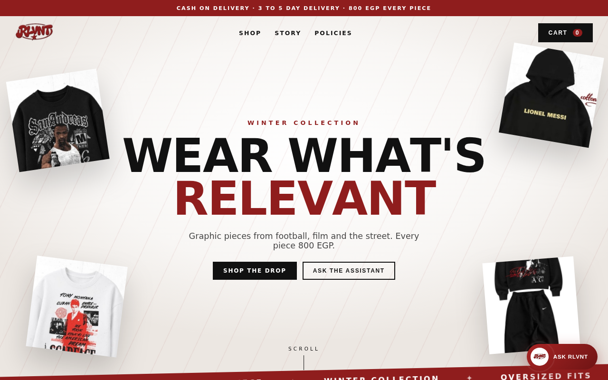

</div>

---

## Contents

[Features](#features) · [Screenshots](#screenshots) · [Architecture](#architecture) · [Flows](#flows) · [Data model](#data-model) · [Tech stack](#tech-stack) · [Project structure](#project-structure) · [API](#api) · [Run locally](#run-locally) · [Environment variables](#environment-variables) · [Security](#security) · [Disaster recovery](#disaster-recovery) · [Roadmap](#roadmap)

---

## Features

| Area | What you get |
| --- | --- |
| **Storefront** | 35 products, category filters, search, sort, saved items, quick view with image gallery and size picker, cart drawer. English-only UI. |
| **AI assistant** | Real LLM with tool calling. Recommends pieces, answers shipping and returns questions, adds and removes cart items. Replies in Egyptian Arabic or English, matching the customer. |
| **Grounding guard** | Every reply is checked for wrong prices, invented discounts, unknown product names and stray scripts. One corrective retry, then a safe fallback. |
| **Provider chain** | OpenRouter, then Groq, then Gemini. If one is rate limited, the next answers. |
| **Checkout** | Cash on delivery. The order is saved to the database first, then emailed. If email fails, the customer still sees a confirmation. If both fail, a WhatsApp fallback link is shown. |
| **Admin panel** | Password-protected. Add, edit, delete, hide, reorder products. Change prices, sizes, images. Edit store settings. See orders. Export and import backups. No redeploy needed. |
| **Resilience** | Catalog and settings live in Redis with a git seed as fallback. Written recovery plan in [DISASTER_RECOVERY.md](DISASTER_RECOVERY.md). |

## Screenshots

<table>
<tr>
<td width="50%"><b>Quick view</b><br>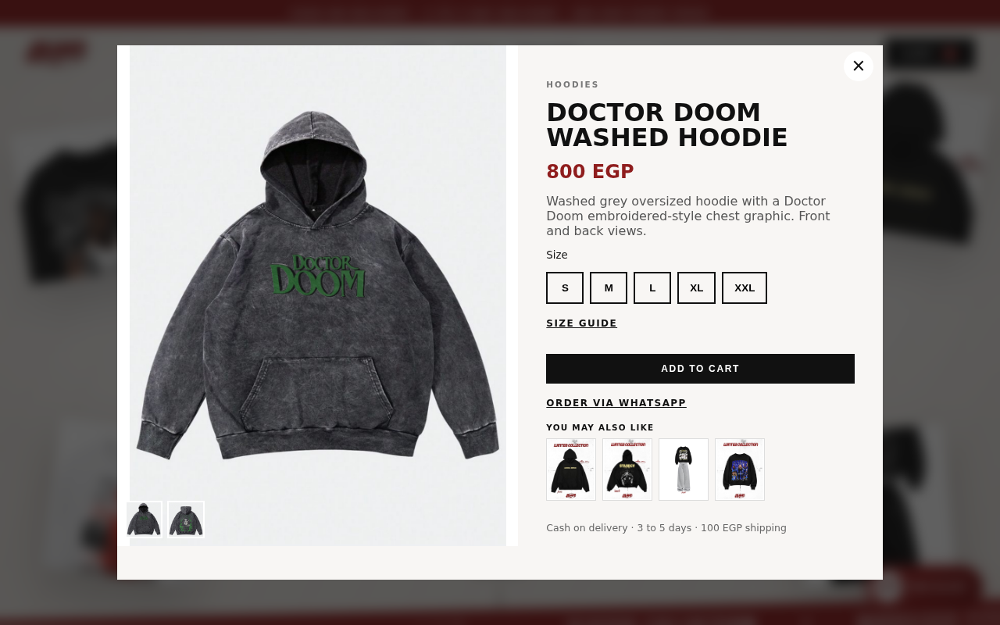</td>
<td width="50%"><b>AI assistant</b><br>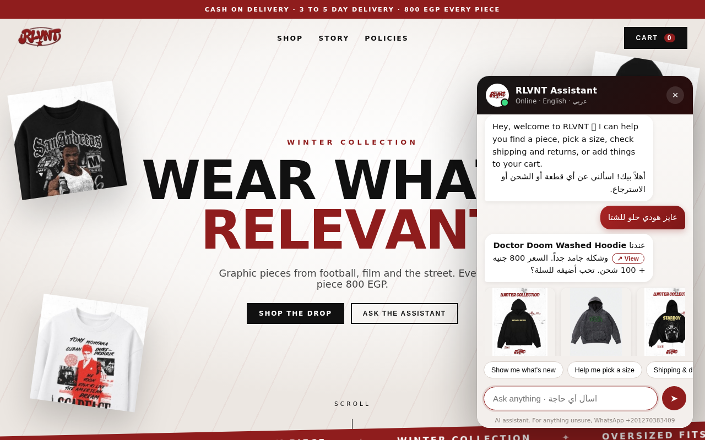</td>
</tr>
<tr>
<td><b>Admin: products</b><br>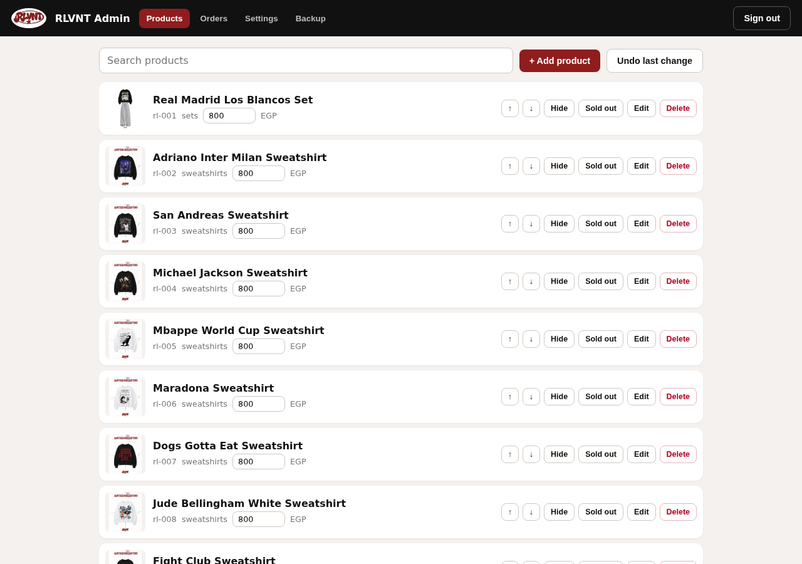</td>
<td><b>Admin: editor</b><br>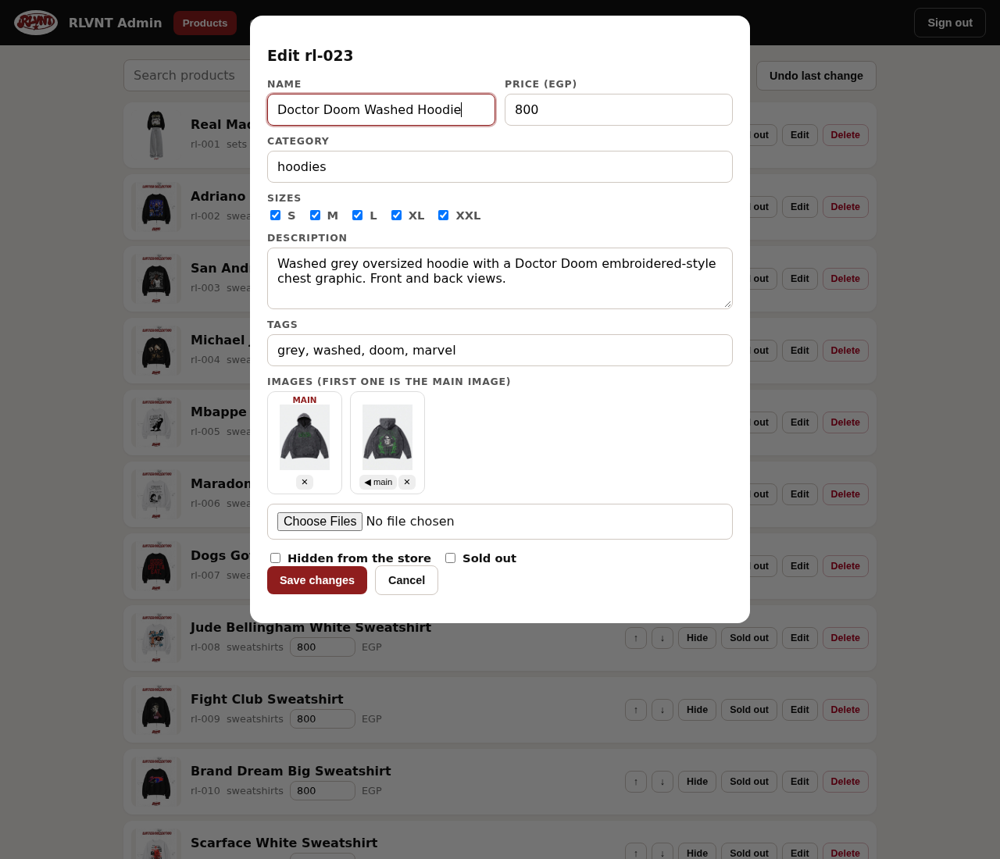</td>
</tr>
<tr>
<td><b>Admin: settings</b><br>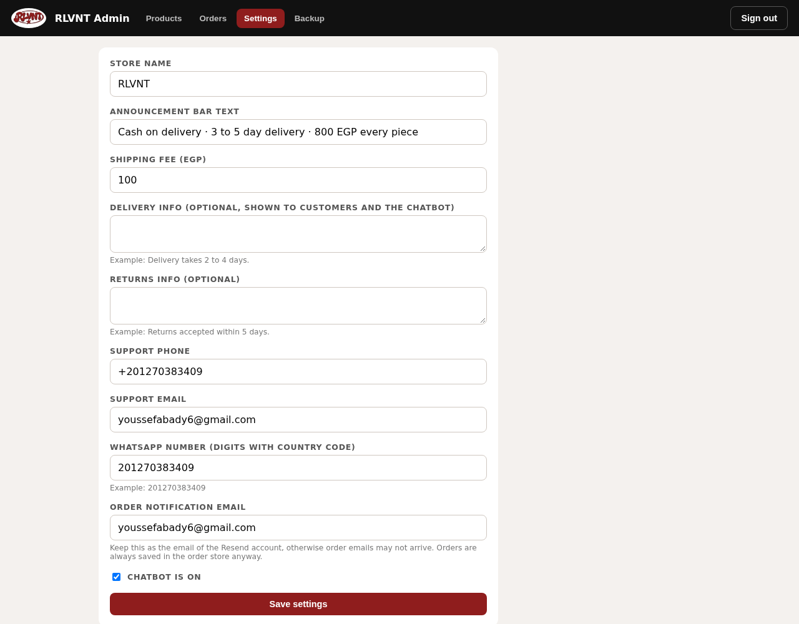</td>
<td><b>Admin: login</b><br>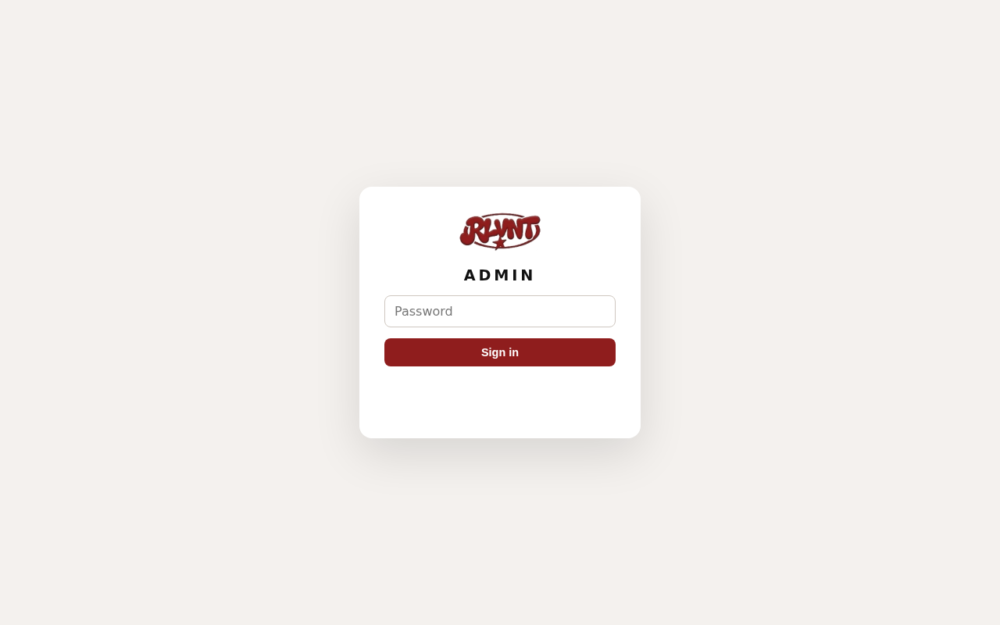</td>
</tr>
</table>

<table>
<tr>
<td align="center"><b>Store (phone)</b><br>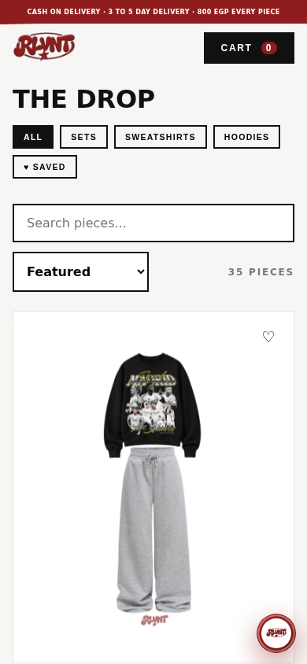</td>
<td align="center"><b>Assistant (phone)</b><br>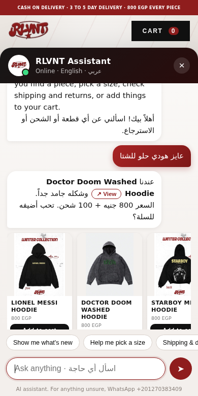</td>
<td align="center"><b>Admin (phone)</b><br>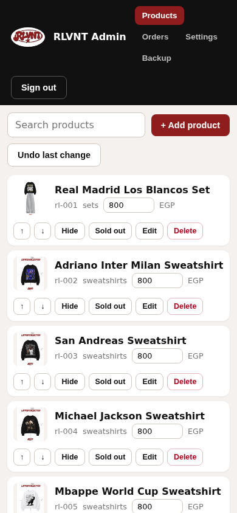</td>
</tr>
</table>

> Admin screenshots were taken on a local copy with demo data and a demo password. The store and chat screenshots come from the live site.

## Architecture

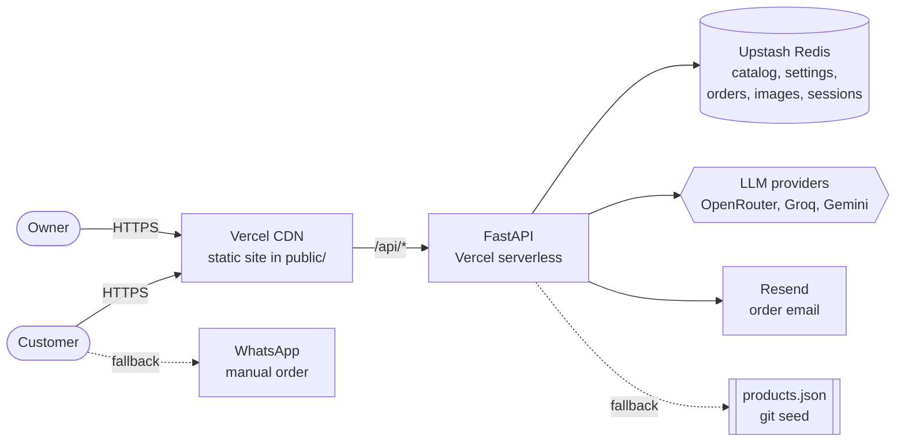

## Flows

### Order flow

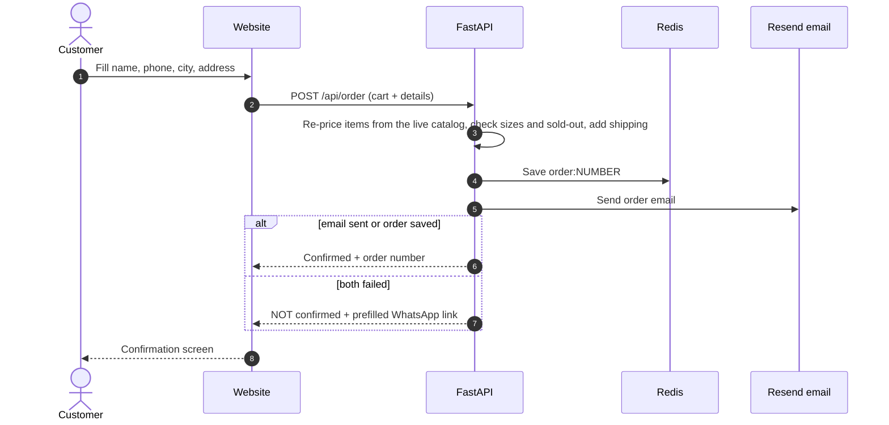

### Chatbot request, guard and fallback chain

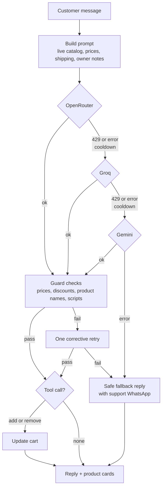

### Admin and data flow

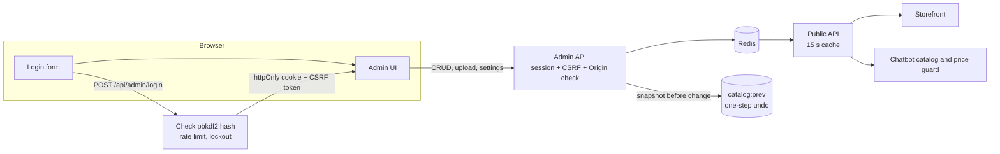

### Deployment

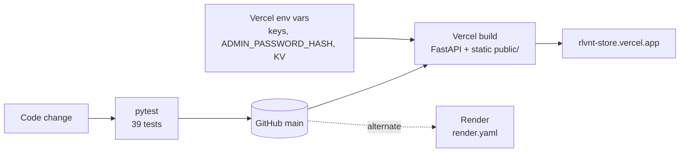

## Data model

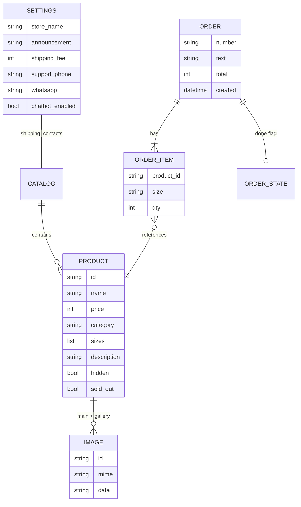

Redis keys: `catalog:products`, `catalog:prev`, `settings`, `order:<number>`, `orderstate:<number>`, `img:<id>`, `admin:s:*` (sessions), `admin:f:*` and `admin:lock:*` (login limits).

## Tech stack

| Layer | Technology |
| --- | --- |
| Frontend | Vanilla HTML, CSS, JavaScript. No build step. |
| Backend | Python, FastAPI, httpx, Pydantic |
| AI | OpenRouter, Groq, Gemini (tool calling) with a custom grounding guard |
| Data | Upstash Redis over REST (free plan) |
| Email | Resend |
| Hosting | Vercel (static CDN plus serverless FastAPI). `render.yaml` for an alternate host. |
| Tests | pytest with fake KV and fake provider transports |

## Project structure

```text
.
├── public/                  static site served by the CDN
│   ├── index.html, app.js, style.css
│   ├── policies.html        shipping and returns, filled from live settings
│   ├── admin.html/.js/.css  admin panel
│   └── images/              product photos and logo
├── backend/
│   ├── app/
│   │   ├── main.py          routes, CORS, chat and order endpoints
│   │   ├── agent.py         LLM loop, provider chain, tools
│   │   ├── guard.py         grounding checks and safe fallback
│   │   ├── knowledge.py     system prompt built from live data
│   │   ├── cart.py, orders.py
│   │   ├── catalog.py       live catalog (Redis, seed fallback)
│   │   ├── settings.py      store settings
│   │   ├── admin.py         auth, admin API, image storage
│   │   ├── kv.py            Upstash REST client
│   │   └── products.json    seed catalog (35 products)
│   └── tests/               pytest suite
├── scripts/catalog_backup.py  backup, verify, restore
├── backups/                 catalog snapshots
├── index.py                 Vercel entry point
├── render.yaml              alternate deploy
└── DISASTER_RECOVERY.md
```

## API

Public endpoints:

| Method | Path | Purpose |
| --- | --- | --- |
| GET | `/api/health` | Health check |
| GET | `/api/products` | Visible products plus public settings |
| POST | `/api/cart/summary` | Price a cart |
| POST | `/api/chat` | Chat with the assistant |
| POST | `/api/order` | Place a cash-on-delivery order |
| GET | `/api/img/{id}` | Uploaded product image |

Admin endpoints (session cookie and CSRF token required, except login and status):

| Method | Path | Purpose |
| --- | --- | --- |
| POST | `/api/admin/login`, `/logout` | Sign in and out |
| GET | `/api/admin/me`, `/status` | Session info, admin enabled |
| GET, POST | `/api/admin/products` | List, add |
| PUT, DELETE | `/api/admin/products/{id}` | Edit, delete |
| POST | `/api/admin/products-reorder` | Reorder |
| POST | `/api/admin/revert` | Undo last catalog change |
| POST | `/api/admin/image` | Upload an image |
| GET, PUT | `/api/admin/settings` | Read, save settings |
| GET | `/api/admin/orders` | Recent orders |
| PUT | `/api/admin/orders/{number}` | Mark done |
| GET, POST | `/api/admin/export`, `/import` | Backup and restore |

## Run locally

```bash
git clone https://github.com/youssefabady-7/rlvnt-store.git
cd rlvnt-store/backend
pip install -r requirements.txt

# optional: at least one provider key for the chatbot
export OPENROUTER_API_KEY=...
# optional: admin panel (generate a hash, never store the password)
export ADMIN_PASSWORD_HASH="$(python -c 'from app.admin import make_hash; print(make_hash(input()))')"

uvicorn app.main:app --reload      # API on http://localhost:8000
```

Open `public/index.html` in a browser (it talks to `localhost:8000` locally). Without Redis the store runs from the seed `products.json`, and admin edits need Redis.

Run the tests:

```bash
cd backend && pytest
```

## Environment variables

Names only. Set them in Vercel (Production) or a local `.env`. Never commit values.

| Name | Required | Purpose |
| --- | --- | --- |
| `OPENROUTER_API_KEY` | one provider key | First chat provider |
| `GROQ_API_KEY` | optional | Second provider |
| `GEMINI_API_KEY` | optional | Third provider |
| `OPENROUTER_MODEL`, `OPENROUTER_FALLBACKS`, `GROQ_MODEL`, `GEMINI_MODEL` | optional | Model overrides |
| `KV_REST_API_URL`, `KV_REST_API_TOKEN` | for admin and orders | Upstash Redis (`UPSTASH_REDIS_REST_*` also accepted) |
| `ADMIN_PASSWORD_HASH` | for admin | Salted pbkdf2 hash of the admin password |
| `RESEND_API_KEY` | for order email | Email delivery |
| `ORDER_EMAIL`, `ORDER_FROM` | optional | Order recipient and sender |
| `ALLOWED_ORIGINS` | optional | CORS list when the API is on another domain |

## Security

- **Admin auth is server-side only.** The password is stored as a salted pbkdf2-sha256 hash (600k iterations) in an env var. No secrets in client code.
- **Session:** random token in an `httpOnly`, `Secure`, `SameSite=Strict` cookie scoped to `/api/admin`, stored server-side for 8 hours.
- **CSRF:** per-session token header plus an Origin check on every state-changing call.
- **Brute force:** 5 failed logins per IP in 15 minutes locks that IP. 25 failures per hour locks everyone. Failed logins are slowed by 1 second.
- **Uploads:** magic-byte check and a 600 KB limit.
- **Orders:** prices are always recomputed on the server from the live catalog. The client price is ignored.
- **Chatbot:** answers are grounded in live data and checked by the guard. It cannot guarantee zero mistakes, so uncertain cases point to WhatsApp support.
- **Privacy:** logs hold minimal personal data. Secrets are never committed (`.env*` and `.vercel` are git-ignored).

## Disaster recovery

Full plan: **[DISASTER_RECOVERY.md](DISASTER_RECOVERY.md)**.

| If this happens | Do this |
| --- | --- |
| Bad product edit | Admin, Products, **Undo last change** |
| Catalog lost or corrupted | Admin, Backup, **Import** a saved export. Fallback is the git seed. |
| Bad code release | `git revert`, push, Vercel redeploys |
| Locked out of admin | Wait 15 minutes, or delete `admin:lock:*` and `admin:f:*` keys in the Upstash Data Browser |
| Forgot the admin password | New hash in `ADMIN_PASSWORD_HASH`, redeploy |
| Order email down | Orders are still saved in Redis and shown in the admin Orders tab |
| Full outage | Take orders on WhatsApp, redeploy from GitHub (Vercel or Render) |

## Roadmap

- [x] Real LLM assistant with cart tools
- [x] Provider fallback chain and grounding guard
- [x] Live admin panel with image upload
- [x] Redis-backed catalog, settings and orders
- [ ] Online payment (card and wallets)
- [ ] Order status page and customer notifications
- [ ] Discount codes
- [ ] Per-size stock counts
- [ ] Paid LLM credits for higher chat limits

## Credits

Brand and products: RLVNT. Rebuilt from the earlier Brand-mind2 project with a working LLM agent, a live admin and a documented recovery plan.

&copy; RLVNT. All rights reserved.
